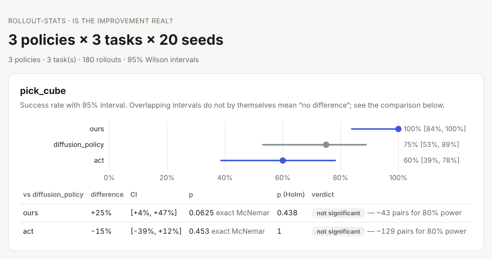

# rollout-stats

**Is your policy's improvement real, or 20 lucky rollouts?**

[](https://github.com/WayneUSC/rollout-stats/actions/workflows/ci.yml)

[](LICENSE)

Real-robot evaluations are expensive, so papers report success rates from 10–50 rollouts — usually as a bare
percentage, often with the best number in bold. At that scale the uncertainty is larger than most of the
differences being claimed:

- **17/25 = 68 %** is anything from **48 % to 83 %** (95 % Wilson interval).
- With 25 rollouts each against a 50 % baseline, the smallest improvement you can reliably detect is **+39 points**.
- Pinning a ~70 % success rate down to ±10 points takes **77 rollouts**, not 20.
- Checking a standard test after every 5 rollout pairs and stopping when p < 0.05 gives **18 % false positives**,
  not 5 %.

`rollout-stats` is a small, dependency-light toolkit that does the right thing for binary success data: exact
tests, intervals that behave at n = 20, paired comparisons when policies share initial conditions, multiple-testing
correction, sample-size planning, and **anytime-valid** sequential tests so you can stop as soon as the answer is
clear — legitimately.

<picture>
  <source media="(prefers-color-scheme: dark)" srcset="docs/assets/report-dark.png">
  
</picture>

**No install needed for the basics:** the [web calculator](https://wayneusc.github.io/rollout-stats/) (English /
中文) answers "how sure is this rate?", "is A better than B?" and "how many rollouts?" in the browser.

## Install

```bash
pip install "git+https://github.com/WayneUSC/rollout-stats"
```

Python 3.10+, NumPy, SciPy, pandas.

## In 60 seconds

```console
$ rollout-stats ci 17 25
17/25 = 68.0%   95% wilson CI [48.4%, 82.8%]   (±17.2%)

$ rollout-stats compare 17/25 11/25 --names ours,baseline
ours: 17/25 = 68.0%  [48.4%, 82.8%]
baseline: 11/25 = 44.0%  [26.7%, 62.9%]
difference +24.0%  95% CI [-3.2%, +46.8%]
boschloo (two-sided): p = 0.101
P(ours better | data, uniform prior) = 0.954
→ inconclusive — the difference could be anywhere from -3% to +47%; far more rollouts are needed

If these rates are the truth, ~73 rollouts per policy give 80% power to detect the difference.

$ rollout-stats plan --p-a 0.8 --p-b 0.6
To detect 80% vs 60% with 80% power (α=0.05, two-sided): 90 rollouts per policy (180 total).
Sequential alternative (anytime-valid, paired A/B rollouts, cap 180 pairs): decides in 90% of runs, median 76 pairs.
```

## A results table you can defend

One row per rollout — `policy, task, seed, success` — is all it needs ([example](examples/rollouts.csv)):

```bash
rollout-stats table rollouts.csv --baseline diffusion_policy --pair-by seed \
    --latex table.tex --html report.html
```

| policy | pick_cube | open_drawer | pour_water | all tasks |
|---|---|---|---|---|
| ours | 100% [84%, 100%] (20/20) | 70% [48%, 85%] (14/20) | 45% [26%, 66%] (9/20) | 72% [59%, 81%] (43/60) |
| diffusion_policy | 75% [53%, 89%] (15/20) | 60% [39%, 78%] (12/20) | 20% [8%, 42%] (4/20) | 52% [39%, 64%] (31/60) |
| act | 60% [39%, 78%] (12/20) | 45% [26%, 66%] (9/20) | 20% [8%, 42%] (4/20) | 42% [30%, 54%] (25/60) |

| vs diffusion_policy | task | difference | p | p (Holm) | note |
|---|---|---|---|---|---|
| ours | pick_cube | +25% | 0.0625 | 0.438 | ~43 pairs for 80% power |
| ours | pour_water | +25% | 0.0625 | 0.438 | ~43 pairs for 80% power |
| ours | all tasks | +20% | 0.0213 (CMH) | 0.17 | |
| … | | | | | |

"Ours" wins on every task and would be bolded in most papers. Paired over shared seeds and corrected for the eight
comparisons in the table, none of it is significant yet — and the table tells you how many more paired rollouts
would settle it. `--latex` writes a booktabs table with intervals; `--html` a report with forest plots.

## Python

```python
import rollout_stats as rs

rs.rate_ci(17, 25)                                   # (0.484, 0.828), Wilson
rs.rate_ci(17, 25, method="clopper-pearson")         # exact, conservative

c = rs.compare(17, 25, 11, 25, "ours", "baseline")   # Boschloo exact test + Newcombe CI + P(better)
c.p_value, c.ci, c.prob_a_better, c.verdict()

rs.compare_paired(ours_outcomes, base_outcomes)      # same seeds / initial conditions: exact McNemar

rs.n_per_arm(0.8, 0.6)                               # 90  (exact Fisher power)
rs.n_for_halfwidth(0.7, 0.10)                        # 77
rs.mde(0.5, 25)                                      # +0.39
rs.power_paired(p_only_a=0.2, p_only_b=0.05, n=40)   # pairing is much more powerful when outcomes correlate

res = rs.Results.from_csv("rollouts.csv", pair_by="seed")
print(res.markdown(baseline="diffusion_policy"))
```

### Stop early, legitimately

```python
seq = rs.SequentialComparison(alpha=0.05)            # run A and B alternately, same initial conditions
for a_success, b_success in run_pairs():
    seq.update(a_success, b_success)
    if seq.decision:                                 # "A better" / "B better"
        break
print(seq.summary())                                 # includes an anytime-valid p-value

lo, hi = rs.confidence_sequence(outcomes)            # success-rate interval valid at every n simultaneously
```

Under the null, continuously monitored, the sequential test rejected in **2.4 %** of 1,000 simulated runs (bound:
5 %); the classical test checked every 5 pairs rejected in **18.3 %**. When the difference is real it decides in
about as many rollouts as a fixed-n design would have needed — without having to fix n in advance.

## What's inside

| | Method | Why |
|---|---|---|
| one rate | Wilson (default), Clopper–Pearson, Jeffreys, Agresti–Coull | Wald intervals collapse to zero width at 0/n and n/n and undercover at small n |
| A vs B | Boschloo exact unconditional test (default), Fisher, Barnard; Newcombe hybrid-score CI for the difference; Bayesian P(A > B) | exact at any n; Boschloo is uniformly more powerful than Fisher |
| paired A vs B | exact McNemar on discordant pairs; Newcombe paired CI | shared initial conditions remove episode difficulty from the comparison |
| several tasks | Cochran–Mantel–Haenszel pooled test, Mantel–Haenszel weighted difference | pools evidence without pretending tasks are one population |
| many comparisons | Holm–Bonferroni | a results table is a family of tests |
| planning | exact power by full enumeration (Fisher, McNemar), n for a target interval width, minimum detectable effect | normal approximations are off at robotics sample sizes |
| sequential | testing by betting (aGRAPA bets, Ville's inequality); hedged-capital confidence sequences (Waudby-Smith & Ramdas 2023) | valid under continuous monitoring and optional stopping |

Everything is checked against reference values and by simulation in the test suite (exact coverage of
Clopper–Pearson, Newcombe's published example, Fisher rejection regions vs SciPy, type-I error of the sequential
test under continuous peeking).

### Notes

- The Newcombe paired interval is a score approximation; with very few discordant pairs it can exclude zero while
  the exact McNemar test does not reject (as in the table above). The verdict always follows the test.
- Statistical significance is not robustness. A policy that is significantly better on 20 seeds of one scene may
  still fail on the next scene — vary the conditions you evaluate on.

## Part of a small toolkit for trustworthy robot data

| | Question |
|---|---|
| [**shortcut-audit**](https://github.com/WayneUSC/shortcut-audit) | Can a model cheat on your dataset? |
| [**anchorsync**](https://github.com/WayneUSC/anchorsync) | Are your sensor streams actually on the same clock? |
| **rollout-stats** | Is your policy's improvement real, or 20 lucky rollouts? |

## References

- Newcombe (1998). Two-sided confidence intervals for the single proportion / interval estimation for the difference
  between independent and paired proportions. *Statistics in Medicine* 17.
- Boschloo (1970). Raised conditional level of significance for the 2×2-table when testing the equality of two
  probabilities. *Statistica Neerlandica* 24.
- Waudby-Smith & Ramdas (2023). Estimating means of bounded random variables by betting. *JRSS-B*.
- Shafer (2021). Testing by betting. *JRSS-A*.

## Citation

```bibtex
@software{chen_rollout_stats_2026,
  author = {Chen, Wen},
  title  = {rollout-stats: honest statistics for robot policy evaluations},
  year   = {2026},
  url    = {https://github.com/WayneUSC/rollout-stats}
}
```

## License

Apache-2.0
